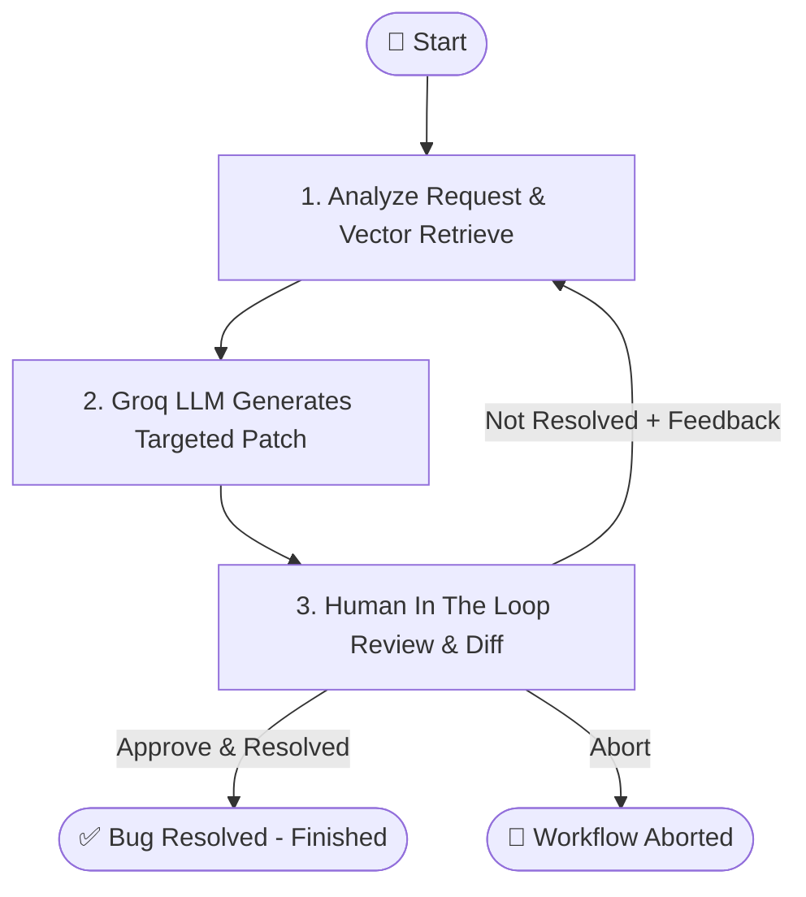

# 🤖 Autonomous Coding Agent with Groq LLM & LangGraph

An intelligent, iterative coding agent powered by **Groq LLM API** (`llama-3.3-70b-versatile`), **LangGraph**, **Chroma Vector Store**, and **Human-in-the-Loop (HITL)** verification.

---

## 🌟 Key Features

1. **Semantic Code Search**:
   - Parses codebases (folders or standalone files), chunks code with line number tracking, and indexes them into a local vector store (using Chroma & lightweight HuggingFace embeddings — no OpenAI key required!).
2. **Intent Analysis & Keyword Extraction**:
   - Uses Groq's high-speed inference to interpret plain English bug reports and extract targeted function names, error types, and search queries.
3. **Targeted Patching (No Full File Rewrites)**:
   - Employs exact search-and-replace blocks. The LLM changes *only the relevant lines* of code, leaving the rest of the codebase untouched.
4. **Human-in-the-Loop (HITL) Feedback Loop**:
   - Renders a color-coded unified diff (`+` additions, `-` deletions).
   - The human approves or rejects the fix.
   - If the human indicates the bug is not resolved and gives feedback, the loop repeats with the fresh feedback fed back into the LLM until the bug is resolved!

---

## 📐 LangGraph Workflow Architecture



---

## 📁 Project Structure

```
Coding Agent/
│
├── .env.example              # Template for API keys and configuration
├── requirements.txt          # Python dependencies
├── main.py                   # CLI & interactive entry point
├── README.md                 # Complete documentation
│
├── agent/
│   ├── __init__.py           # Agent package initialization
│   ├── state.py              # TypedDict definitions for LangGraph state
│   ├── retriever.py          # Vector store indexing & semantic retrieval (Chroma)
│   ├── patcher.py            # Targeted search-and-replace engine & diff generator
│   ├── nodes.py              # LangGraph node implementations & human review
│   └── graph.py              # LangGraph StateGraph builder & conditional routing
│
└── sample_codebase/          # Pre-configured test project with an intentional bug
    ├── calculator.py         # Contains ZeroDivisionError bug in calculate_discount()
    ├── utils.py              # Helper utility functions
    └── test_sample.py        # Unit test verifying the bug
```

---

## 🚀 Getting Started

### 1. Prerequisites
- Python 3.10, 3.11, or 3.12 installed.
- A **Groq API Key** (Free from [console.groq.com/keys](https://console.groq.com/keys)).

### 2. Setup Virtual Environment & Install Dependencies

```bash
# Optional: create a virtual environment
python -m venv venv

# Activate virtual environment
# Windows:
.\venv\Scripts\activate
# Linux/macOS:
source venv/bin/activate

# Install dependencies
pip install -r requirements.txt
```

### 3. Configure API Key
Create a `.env` file in the project root:

```bash
cp .env.example .env
```

Open `.env` and paste your Groq API key:
```env
GROQ_API_KEY=gsk_your_actual_groq_api_key_here
GROQ_MODEL=llama-3.3-70b-versatile
```

---

## 💻 Running the Coding Agent

### Method 1: Interactive Mode (Recommended)
Simply run:
```bash
python main.py
```
You will be prompted for:
1. The path to your codebase (defaults to `./sample_codebase`).
2. The bug or task in plain English (e.g., `"Fix the ZeroDivisionError in calculate_discount when total_items is 0"`).

---

### Method 2: Direct CLI Flags
Pass arguments directly for automated or scripted runs:

```bash
python main.py --path ./sample_codebase --task "Fix ZeroDivisionError in calculate_discount when total_items is 0"
```

Options:
- `--path`, `-p`: Path to codebase directory or specific file.
- `--task`, `-t`: Bug description in plain English.
- `--max-iterations`, `-m`: Maximum retry attempts before stopping (default: `5`).
- `--model`: Groq model override (default: `llama-3.3-70b-versatile`).

---

## 🧪 Testing with the Included Sample Codebase

The included `sample_codebase/calculator.py` contains a bug on line 17:
```python
average_item_price = total_amount / total_items
```
Running `python sample_codebase/test_sample.py` will fail with:
```
ZeroDivisionError: float division by zero
```

### Run the Agent on it:
```bash
python main.py --path ./sample_codebase --task "Fix ZeroDivisionError in calculate_discount when total_items is 0"
```

1. **Step 1**: The agent extracts keywords (`calculate_discount`, `total_items`, `ZeroDivisionError`).
2. **Step 2**: Vector search locates `sample_codebase/calculator.py` around lines 10-25.
3. **Step 3**: Groq LLM proposes a targeted fix (adding `if total_items == 0: ...`).
4. **Step 4 (HITL)**: You see the unified diff in your console.
   - Press `1` to **Approve & Mark Resolved**.
   - Or press `2` to **Reject and provide feedback** (e.g. `"Ensure it returns 0.0 when items is 0"`).
5. **Step 5**: Re-run `python sample_codebase/test_sample.py` to confirm all tests pass!
